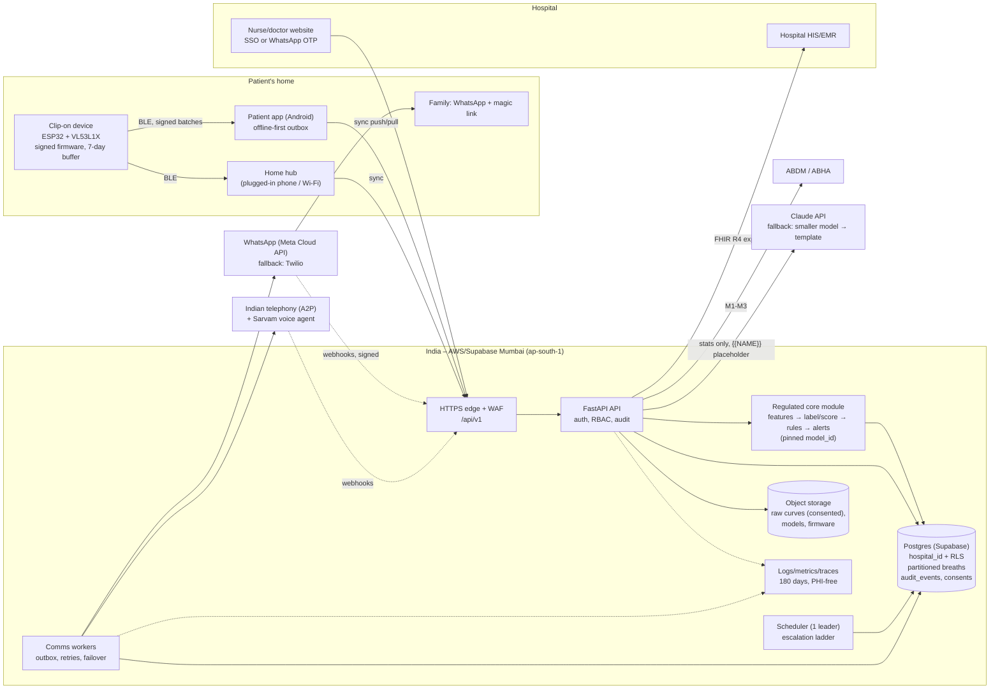

# SpiroBuddy – future architecture (demo → many hospitals)

**Written:** 10 Oct 2026, solutions-architect session. **Status:** proposal for decisions, not built. Nothing here changes today's contracts in `ARCHITECTURE.md`.
**Sources:** `[#n]` = row in `docs/research/SOURCES_LEDGER.md` (reused, not re-read). `[W1]`… = new sources opened for this document (list at the end). **(est.)** = our estimate. **(?)** = uncertain, check before relying on it.

## In plain English (read this first)
1. Today SpiroBuddy is a good demo: one server, fake patients, no login, data partly in Singapore. A real hospital can't use it like that.
2. The path is three steps: **one pilot hospital (~50 patients)**, then **10–50 hospitals**, then **national scale (100,000+ patients)**. Each step adds things only when a clear trigger happens, so we don't over-build.
3. Before the first real patient we must have: data kept in India (Mumbai), logins for staff, a record of who looked at what, written consent records, backups, and an ethics-approved pilot.
4. A few choices are cheap now and very expensive later: tag every row with its hospital, put a version number in the API, never put patient details into the AI or the logs, and give every breath a unique ID so phones and devices can re-send safely.
5. Running costs look fine: roughly **₹50–120 per patient per month** in messages, calls and AI, plus a fixed server bill that shrinks per patient as we grow (est.). Selling at ₹500–1,000 per patient leaves room. The bigger cost is regulatory work: we expect **CDSCO Class B** and will need a quality system (ISO 13485) before we sell.

**Everyday comparison:** today we have a show flat. A real building needs foundations (data, logins, logs), wiring rules (regulation) and a lift that works for 1,000 people (queues and scaling). The foundations have to go in before the walls. Retrofitting them later means knocking walls down.

---

## 0. Where we are today (facts from the code, 10 Oct 2026)

| Area | Today | Why it matters later |
|---|---|---|
| Hosting | One Render web service, `region: singapore`, free plan (`render.yaml`) | Render has **no India region** (Oregon, Ohio, Virginia, Frankfurt, Singapore) and can't move a service between regions [W3] |
| Database | Supabase via PostgREST with the **service_role key** (bypasses RLS); SQLite fallback | One bug = every hospital's data. RLS is on but has no policies, so it doesn't protect anything once the server is the only caller |
| IDs | `bigint identity` IDs exposed in URLs (`/api/patients/1`) | Guessable. Hard to merge data from offline phones and many hospitals |
| Tenancy | No hospital column anywhere | Adding it later touches every table, query and test |
| API | `/api/...`, no version | The patient app and devices in the field will break on any change |
| Login | None (`DEMO_MODE=1`) | Can't go live |
| Background work | Escalation "ticker" is a thread inside the web process (`routes_comms.py`) | Two server copies = double calls; a sleeping free instance = missed alerts |
| Guardian links | `secrets.token_urlsafe(9)` (72 bits), stored in plain text, no expiry (`comms/guardians.py`) | Fine for a demo; for real data, links must expire, be revocable and be hashed at rest |
| Webhooks | Twilio: signature checked (good). Sarvam: shared secret in `?token=` URL (Sarvam documents no signature) | URL secrets end up in access logs |
| LLM | Claude `claude-opus-5-5`; only the first name and day stats are sent; template fallback (`llm.py`) | Already good practice. Keep the rule as we add features |
| Device | ESP32 + VL53L1X over USB serial into Chrome (CONTRACT A) | Not usable at home. No device identity, no updates |
| ML | RandomForest in `ml/model.joblib`, retrained by `/api/train` | A regulated device can't retrain itself from a button |

---

## 1. Phased roadmap and load

### 1.1 Targets per phase (all numbers are estimates)
Assumptions: an "active patient" is on the programme that day; ~14 waking-hour slots × 10 breaths = 140 breaths/day if perfect, ~70 realistic (50% adherence); ~3 WhatsApp messages per patient per day (patient reminder + guardian summary + one reply/nudge); ~1 automated call per patient per week.

| | **Pilot** | **Multi-hospital** | **National** |
|---|---|---|---|
| Hospitals | 1 | 10–50 | 300+ (incl. TB programme sites) |
| Patients enrolled | ~50 over 3 months | ~5,000 active at once | 100,000+ active at once |
| Breaths/day | ~3,500 (~0.04/s) | ~350,000 (~4/s avg) | ~7 million (~80/s avg) |
| Peak breaths/s (everyone breathes on the hour) | <5 | ~100 | ~2,000 |
| Breath rows/year (features only, ~300 B each) | ~1 M (0.3 GB) | ~130 M (~40 GB) | ~2.5 B (~750 GB) |
| WhatsApp messages/day | ~150 | ~15,000 | ~300,000 |
| Automated calls/day | ~5 | ~700 | ~15,000 |
| LLM calls/day | ~50 | ~5,000 | ~100,000 |
| Staff users | ~10 | ~500 | ~10,000 |

**What creates load:** breaths arrive in bursts at the top of each hour, so ingestion must be **append-only and batched** (a session uploads 10 breaths in one request). Raw 30 Hz curves are 240 numbers per breath; at national scale that's ~1.7 billion numbers a day, so **we keep only features by default** and keep raw curves for a small consented sample used for ML labels.

### 1.2 What each phase adds (and the trigger)

| Phase | Must be true before entering | Trigger to start |
|---|---|---|
| **Pilot** | India hosting, staff login, roles, audit log, consent records, backups + PITR, `/api/v1`, tenant_id, BLE device or nurse-tablet capture, ethics approval + CTRI registration (?), signed data-processing agreement with the hospital, VAPT done | A signed pilot agreement with one hospital |
| **Multi-hospital** | Tested tenant isolation, hospital SSO, queue workers, on-call rota, staging environment, ISO 13485 QMS in place, CDSCO class confirmed and application filed, WhatsApp Business verified on our own number | Pilot data shows it works **and** a second hospital signs; **hard trigger: the 3rd hospital** |
| **National** | Read replicas, monthly partitions, data retention jobs running, multi-provider comms failover, ABDM integration, CDSCO licence, 24×7 on-call | ~20,000 active patients **or** a state/national programme contract |

---

## 2. Identity and access

### 2.1 Who logs in, and how
| User | Today | Target | Why |
|---|---|---|---|
| Nurse / doctor / hospital admin | No login | **Hospital SSO** (OpenID Connect or SAML from the hospital's Microsoft/Google account) where the hospital has it; otherwise **phone + OTP via a WhatsApp authentication template**, plus a 6-digit PIN on shared ward tablets. Sessions 12 h, re-auth for exports | Hospitals already manage their staff accounts; SMS OTP in India needs DLT registration (1–3 weeks, per template) [#108], WhatsApp OTP doesn't |
| SpiroBuddy support staff | – | Separate admin realm, hardware key (FIDO2), no standing access to patient data; break-glass only | Our own staff are the biggest insider risk |
| Guardian | Magic link, never expires | Magic link that is **≥128-bit, stored hashed, expires in 30 days, renewed by WhatsApp**, read-only, shows first name only; can be revoked by the patient ("STOP") or nurse | Matches Part D rule "no login for family" while closing the forwarded-link risk |
| Patient | None (device + calls) | Still **no login** by default. If they use the app: one-time **pairing QR** printed at discharge (binds app ↔ patient ↔ device), then a long-lived refresh token on that phone | FEATURE_PLAN Part D rule 1: never require the patient to log in |
| Device | None | Per-device key (see §4) | Stops fake devices from posting breaths |

**Tool choice:** Supabase Auth (supports SAML SSO on Team plan, phone OTP, JWTs) for staff, so we don't run our own password store. The **FastAPI server stays the only thing that talks to the database** (as today). (Supabase lists SAML SSO under Team, priced per SSO user; confirm with sales [W2].)

### 2.2 Roles (RBAC) – permissions per role
| Action | Nurse | Doctor | Hospital admin | Guardian | Patient | Support |
|---|---|---|---|---|---|---|
| See own ward's patients | ✔ | ✔ | ✔ | own patient, summary only | self | break-glass |
| Change target / care plan | ✔ | ✔ | – | – | – | – |
| Acknowledge alerts | ✔ | ✔ | – | – | – | – |
| Add/discharge patient, pair device | ✔ | ✔ | ✔ | – | – | – |
| Manage staff, export data | – | – | ✔ | – | – | – |
| See other hospitals | never | never | never | never | never | break-glass, logged |

Scope = role **+ hospital + ward**. Ward-level scope is stored on the staff membership row, not hard-coded.

### 2.3 Multi-tenant isolation – **decision: shared tables + `hospital_id` + Postgres RLS**, with an optional dedicated database for big customers
- **Options:** (a) shared tables with a `hospital_id` column and Row Level Security; (b) one schema per hospital; (c) one database per hospital.
- **Choice: (a) for everyone, (c) only when a contract demands it** (e.g. a government programme or a large chain). Same code, different connection string.
- **Why not schema-per-tenant:** at 50–300 hospitals every migration runs 300 times, cross-hospital analytics and ML training need 300-way unions, and connection pools multiply. It buys little over RLS for our data sizes.
- **How (a) is made safe:**
  1. Every table gets `hospital_id uuid not null` (even `breaths`, denormalised, so policies don't need joins).
  2. The server stops using the **service_role** key for normal requests. It connects as a restricted Postgres role and runs `SET LOCAL app.hospital_id = '…'` (and `app.user_id`, `app.role`) at the start of each transaction. RLS policies check `hospital_id = current_setting('app.hospital_id')::uuid`.
  3. The application also filters by hospital (defence in depth). An automated test logs in as hospital A and tries to read every endpoint for hospital B's IDs; it must get 404.
  4. service_role is kept only for migrations and break-glass, stored in a secrets manager.
- **Migration step:** add `hospital_id` with a default "demo hospital" UUID now → backfill → set NOT NULL → add policies → switch the server from PostgREST/service_role to a direct Postgres connection (psycopg) with the restricted role. **Effort:** 3–5 dev-days now; 3–4 weeks if done after the app and devices exist (est.). **Trigger:** now (cheap); RLS enforcement before the 2nd hospital.

### 2.4 Audit log and break-glass
- **Audit log:** append-only table `audit_events(id, at, hospital_id, actor_id, actor_role, action, resource_type, resource_id, patient_id, reason, ip, user_agent, request_id, prev_hash, hash)`. Written in the **same transaction** as the change; reads of patient pages are logged too ("view"). Hash-chained so tampering shows. Nobody, including us, has UPDATE/DELETE on it.
- **Retention:** at least **1 year** (DPDP Rules 2025 rule 6 asks for access logs kept one year [#122]) and ICT logs **180 days inside India** (CERT-In directions 2022 [W4]). We'll keep audit events for the life of the clinical record (est. policy; confirm with the hospital's record rules).
- **Break-glass:** a nurse or our support engineer can open a patient outside their scope only by typing a reason; access lasts 60 minutes, the hospital admin is notified immediately, and every break-glass event is listed in a weekly review screen.
- **Cost/effort:** 3–4 dev-days for the table + middleware; 2 days for the review screen. **Trigger:** before the first real patient.

---

## 3. Data

### 3.1 Schema evolution and migrations
- **Today:** one `supabase/schema.sql` with `create table if not exists`; SQLite created from code.
- **Target:** numbered, forward-only SQL migrations in `supabase/migrations/` (Supabase CLI format, plain SQL so they also run on any Postgres). CI applies them to a fresh database and to a copy of staging on every pull request. "Expand → migrate → contract": add new column, dual-write, backfill, switch reads, drop old column in a later release. No destructive change in the same release as the code that needs it.
- **SQLite:** keep for the offline demo only; stop promising parity with production after the pilot (it doubles every migration).
- **Effort:** 1–2 days. **Trigger:** now (the next schema change).

### 3.2 Time-series breath data – **decision: plain Postgres with monthly partitions (pg_partman), not TimescaleDB**
- **Why:** Supabase has **deprecated the timescaledb extension on Postgres 17** and recommends native partitioning with pg_partman [W5]. Our volumes (≤ ~750 GB/year at national scale, §1.1) are well within plain Postgres when partitioned.
- **Design:**
  - `breaths` partitioned by month on `started_at`; indexes on `(hospital_id, patient_id, started_at)`.
  - `sessions` and `slots` stay small and unpartitioned until ~50 M rows.
  - Nightly roll-up table `patient_day(hospital_id, patient_id, date, sessions_done, best_ml, avg_score, label_counts)` feeds the dashboard and 7-day charts, so the dashboard never scans breaths.
  - Raw curves (`samples`) go to object storage (Supabase Storage / S3 Mumbai) as compressed files, only for consented ML-label sessions.
- **Migration step:** create partitioned `breaths_v2`, copy, swap name. **Effort:** 2–3 days. **Trigger:** before multi-hospital (≥1 M breath rows).

### 3.3 Retention and deletion
| Data | Keep for | Then |
|---|---|---|
| Breath features, sessions, alerts, care-plan changes | Episode + hospital's record-retention period (contract; often several years for inpatient records) (?) | Hard delete or hand over to the hospital |
| Raw breath curves (ML label sample) | 2 years after consent, or until consent is withdrawn | Delete; models trained earlier keep only aggregate weights |
| WhatsApp/call content and transcripts | 90 days (est. policy) | Keep only the outcome code |
| Audit events | ≥1 year (DPDP rule 6) and for the record's life | Archive cold |
| Server/app logs | 180 days in India (CERT-In) [W4] | Delete |
| Backups | 30 days rolling | Expire – deletions "catch up" when old backups expire; we state this in the privacy notice |

Who decides: under DPDP the **hospital is the Data Fiduciary** for clinical data and we are its **Data Processor** (our reading of the Act's definitions [W6]; confirm with counsel). For guardian phone numbers and app accounts we may be a fiduciary ourselves. The contract must say which.

### 3.4 Backups, point-in-time recovery (PITR), disaster recovery
- **Target:** Supabase PITR (7 days in pilot, 14 days multi-hospital) plus a **nightly encrypted logical dump to a separate cloud account in Mumbai** (protects against account compromise or vendor lock-out). Quarterly restore drill, written up.
- **Price:** PITR ≈ US$100/month for 7 days, $200 for 14, $400 for 28 days per project [W1].
- **RPO/RTO** in §8.

### 3.5 India data residency
- **Target:** database **Supabase `ap-south-1` (Mumbai)** – a "specific region" option, which Supabase recommends for residency needs [W7]. App servers in the **same AWS Mumbai region** (Render can't do India [W3]).
- **Law:** the DPDP Act doesn't ban transfers abroad; section 16 lets the government **blacklist** countries [W6]. CERT-In wants logs kept in India [W4]. Hospitals and government buyers will usually require India storage anyway, so we design for it.
- **Third-party processors outside India:** Anthropic (Claude API is "global" by default; US-only routing is a 1.1× option; no India routing listed [W8]), Twilio, Meta. Rule: **they get no personal data that identifies the patient** (§6.5). Then residency is a non-issue for them.
- **Migration step:** create Mumbai Supabase project → migrate data → move app to Mumbai → delete Singapore. Supabase and Render projects can't change region in place [W3][W7]. **Effort:** 2–3 days. **Trigger:** before the first real patient (until then, fake data only).

### 3.6 Encryption
- In transit: TLS 1.2+ everywhere, HSTS; webhooks HTTPS only.
- At rest: provider disk encryption (Supabase/AWS) **plus** column-level encryption (pgcrypto or app-side with a key in a KMS) for phone numbers, names and guardian contacts. Phone numbers also stored as a keyed hash for lookups from WhatsApp webhooks.
- Keys: cloud KMS in Mumbai; rotation yearly.

### 3.7 DPDP Act 2023 – consent records and rights
Most DPDP Rules duties start around **May 2027** [#122]; build them in now because the pilot will run into that date.
- **Consent record table** `consents(id, hospital_id, patient_id, subject: patient|guardian, purpose: care_updates|reminder_calls|ml_research|family_sharing, notice_version, language, method: voice|tap|paper, evidence_ref (audio/photo hash), given_at, expires_at, withdrawn_at, withdrawn_via)`. Today's `care_settings.consent` flag + date becomes a row per purpose. **Separate consent for ML research** – care consent never covers model training.
- **Notice:** itemised, plain language, in the patient's language, read aloud (rule 3 [#122]; already designed in `consent.py`). Version every notice text.
- **Rights (Act ss. 11–13 [W6]):**
  - access → "My data" summary PDF/voice note on request (nurse button + WhatsApp keyword);
  - correction/erasure → request ticket, erasure unless another law requires keeping it (clinical records usually do – then restrict instead of delete);
  - grievance → named **Grievance Officer** with contact in every notice; response within the period the Rules set (we recall 90 days – check rule text) (?).
- **Breach:** tell affected people and the Data Protection Board within **72 hours** (rule 7 [#122]); tell CERT-In within **6 hours** of noticing a reportable incident [W4]. One runbook serves both (§8.5).
- **Guardian ≠ legal guardian:** the adult patient consents personally (rule 11 [#122]).

### 3.8 ABDM / ABHA and FHIR export (hospital HIS/EMR integration)
- **Target:** a read-only **FHIR R4 export** per patient episode, profiled on India's **ABDM FHIR IG v6.5.0** (NRCeS) [W9]:
  - `Patient`, `Organization`, `Practitioner` (from the hospital),
  - `CarePlan` (target mL, hold time, sessions/day),
  - `Observation` per **day** (not per breath): best volume (mL), sessions done, technique label counts – using the IG's `Observation`/`ObservationGeneralAssessment` profiles (there is **no lung-function-specific profile** and **no Device profile** in the IG [W9]; use base FHIR R4 `Device` for the clip-on),
  - bundled into a `WellnessRecord` or `HealthDocumentRecord` composition for ABDM sharing.
- **ABDM path:** become an ABDM-integrated app in the sandbox: **M1** (ABHA create/verify), **M2** (link care contexts so records show in the patient's ABHA), **M3** (consent-based sharing); production keys only after the milestones are certified [W10]. Likely we act as a **HIP** (health information provider) for the episode summary.
- **HIS integration:** most Indian HIS products accept HL7 v2 or CSV more often than FHIR (?). Offer: FHIR API + nightly CSV/PDF discharge-follow-up report; build HL7 v2 only when a paying hospital asks.
- **Effort:** FHIR export 2 weeks; ABDM M1–M3 1–3 months incl. certification (est.). **Trigger:** first hospital that asks, or by multi-hospital phase; mandatory for government programmes.

---

## 4. Device fleet

**Main point:** the clip-on must work at home with no laptop, prove who it is, update itself safely, and survive being lost or passed to the next patient.

| Topic | Today | Target | Why / how | Effort · trigger |
|---|---|---|---|---|
| Link | USB serial → Chrome | **BLE (Bluetooth Low Energy)** to the patient app or to a **home hub** (a cheap Android phone left plugged in, or a Wi-Fi ESP32 hub) | 59% of older Indians have no smartphone (PITCH_FACTS #13), so the hub path is essential, not optional | 3–4 weeks firmware + app · pilot |
| Protocol | CONTRACT A text lines | Versioned BLE GATT service: `info` (fw version, serial, battery), `breath_summary` notifications (features + seq no.), `live` stream (for coaching), `control` (beep, sync, OTA). Keep CONTRACT A on USB for lab use | Features are ~40 bytes; live stream only while the app is open | with BLE |
| Device identity | None | Each device gets a **serial + key pair at manufacturing**; private key in protected flash/eFuse; public key registered in our `devices` table. Breath batches are **signed** by the device; server rejects unknown/unsigned devices | Stops anyone posting fake breaths for a patient (device spoofing, §9) | 1 week · pilot |
| Pairing | – | Nurse scans **device QR + patient wristband/QR** at discharge → `device_assignments(device_id, patient_id, hospital_id, from, to)`. Breaths are always attributed via the assignment window, never by trusting the phone | One device serves many patients over its life | 3 days · pilot |
| OTA firmware | Manual USB flash | Signed images (ESP32 **Secure Boot v2** verifies every boot and every OTA), **flash encryption**, **app rollback** (new image must mark itself valid after a self-test, else the bootloader returns to the old one), **anti-rollback** security version in eFuse (only 32 increments – use sparingly) [W11]. Images delivered via the phone/hub; staged rollout 1% → 10% → 100% with automatic halt on error-rate rise | A bad update to 10,000 devices is a recall | 2–3 weeks · before multi-hospital |
| Calibration | localStorage in the browser | `calibrations(device_id, spirometer_model, points[{raw, ml}], method, by, at, check_result)` on the server, pushed to the device/app. Factory calibration per **spirometer model** + a 2-point bedside check at pairing | Accuracy claims (PITCH_FACTS #37) must be traceable per device for the regulator | 1 week · pilot |
| Offline buffering | None | Device stores ≥7 days of breath summaries in a flash ring buffer with a **monotonic sequence number**; sync on connect; server de-duplicates on `(device_id, seq)` | Patients go out of range, phones die | with BLE |
| Telemetry | – | Battery %, fw version, sensor error rate, last-seen, mounting-check failures → `device_health`; dashboard shows "device not seen 24 h" separately from "patient missed sessions" | A dead battery isn't non-adherence | 3 days · pilot |
| Lifecycle | – | States: `in_stock → assigned → returned → cleaning → ready` and `lost`, `faulty`, `retired`. Cleaning step records disinfectant + who + when (the clip touches only the outside of a single-patient spirometer; cleaning procedure needs a validated IFU) (?) | Hospital audit and infection control | 3 days · pilot |
| Hardware | XIAO ESP32-C3 + VL53L1X | Same family is fine (ESP32-C3 supports Secure Boot v2 from chip rev v0.3 [W11]); add battery gauge and buzzer; design for IP rating and cleaning | – | hardware rev · pilot |

---

## 5. Patient mobile app (built by the user against `/api`)

- **Offline-first:** local SQLite with an **outbox**; every record created on the phone gets a client UUID (`session_uid`, `breath_uid`) so re-sending is safe.
- **Sync protocol (new, CONTRACT F – to be added to ARCHITECTURE.md when built):**
  1. `POST /api/v1/sync/push` – batch of sessions/breaths/events, each with its client UUID and device signature; server answers per item `accepted | duplicate | rejected(reason)`.
  2. `GET /api/v1/sync/pull?since=<cursor>` – care plan, target, language, reminders, cheers changed since the cursor. Server wins for care-plan fields; device wins for measurements.
  3. Header `Idempotency-Key` on every POST; server stores keys 7 days.
- **Push notifications:** Firebase Cloud Messaging for app reminders; but **reminders must not depend on push** (low-end Android kills background apps). The device beep and WhatsApp remain the primary reminders.
- **Low-end Android:** target Android 8+, ≤ 30 MB install, works on 2 GB RAM; audio packs per language downloaded once (pre-recorded clips = no TTS cost, works offline).
- **Accessibility for elderly:** voice-first, one action per screen, text ≥ 18 px (24 px default), high contrast, TalkBack labels, no typing, big 1/2/3 choices (FEATURE_PLAN Part D).
- **API contract sharing:**
  - **Version now:** serve everything under **`/api/v1`**; keep `/api` as an alias for the website until it is switched, then retire it.
  - **Rules:** within v1 only *add* fields/endpoints; never rename or remove. Breaking change = `/api/v2`, with v1 kept ≥ 12 months (devices and old phones live long).
  - **Contract tests:** commit FastAPI's generated `openapi.json`; CI fails if a change removes/renames anything in v1. The app's test suite runs against a recorded mock of the same spec. Each response carries `X-API-Version` and the app sends `X-Client-Version` so we can see who is still on old builds.
- **Effort:** versioning 1 day now; sync endpoints 1–2 weeks. **Trigger:** versioning now; sync before the app ships.

---

## 6. AI / ML

### 6.1 Breath classifier – model registry and versions
- **Today:** `ml/model.joblib`, retrained by `POST /api/train` on the live server.
- **Target:** models are built in CI or a notebook pipeline, never on the production server. Each model is an immutable artifact: `model_id`, git commit, training-data snapshot hash, metrics on a **frozen test set of real Indian patient breaths**, approval record. Stored in object storage; the server loads a pinned `model_id` from config.
- **Every breath row stores `model_id`, `rules_version`, `firmware_version`** – so any label can be traced (IEC 62304 / post-market surveillance need this).
- **Remove `/api/train` from production** (keep it in the demo build).

### 6.2 On-device vs server inference
- **Live coaching** ("slower!") must run **on the device or phone** (latency <100 ms, works offline) using the fixed **rules** in CONTRACT C; later a tiny model (emlearn [#15]).
- **The recorded label/score** used by nurses comes from **one authoritative place**. Decision: the **server** model for v1 (easy to update and audit), with the rules as fallback; on-device model only after it's validated as identical.

### 6.3 Monitoring and drift
- Daily job: distribution of each feature and label mix per hospital, per firmware version, per spirometer model; alert when it shifts beyond a threshold (e.g. population stability index > 0.2 (est.)).
- **Shadow mode:** a new model runs alongside the live one for ≥ 4 weeks; its labels are stored but not shown; switch only after comparison and sign-off.

### 6.4 Human-in-the-loop labels
- Nurses label a small random sample per week in a "Review breaths" screen (the raw curve + video-less replay), plus physiotherapist-supervised `collect.html` sessions. Two-rater agreement on a subset.
- Only from patients with **ML research consent** (§3.7). Labels stored with labeller ID and time.

### 6.5 LLM guardrails (Claude for summaries and call scripts)
1. **Never in the clinical decision path:** alerts, red flags and status colours come from rules in code (already true: `rules.py`, `voice.red_flag`, `messages.RED_FLAG_RE`). Keep it that way in every new feature.
2. **No personal data in prompts:** send `{{NAME}}` instead of the first name and re-insert it after the reply; send day stats only; never surgery type, phone, address or free-text patient words. Today we send the first name – change to a placeholder (small change).
3. **Red-flag check runs before the LLM** on any patient text; if it fires, the fixed "contact your nurse / call 112" message is sent and the LLM is not called.
4. **Output filter** after the LLM: block disease names, drug names, numbers not in the input, "diagnosis"-type words → template fallback.
5. **Vendor fallback chain:** Claude (primary) → a cheaper Claude model → template. A second vendor is optional; the template is the real safety net. Timeouts 5 s.
6. **Cost control:** per-hospital daily budget; batch the evening summaries through the **Batch API (50% off)** [W8]; use a small model for routine summaries (Opus 5.5 is $4/$20 per million input/output tokens; Haiku 5.5 is $0.10/$0.50 [W8]). At ~600 tokens in / 200 out, one Opus summary ≈ US$0.006 (≈ ₹0.56) and one Haiku summary ≈ US$0.00016 (≈ ₹0.01) (est., ₹88/US$).
7. **Prompts are versioned files**, with tests that run each prompt on fixed inputs and check the guard rules.
8. **Disclosure:** every AI-written message says it's automated (already done in comms).

*Note:* `CLAUDE.md` fixes the model to `claude-opus-5-5` for the hackathon. Moving routine summaries to a smaller model is a recommendation for after the hackathon, not a change now.

### 6.6 What regulation means for changing a model after approval
- CDSCO's 2026 software guidance treats software that **alerts** about a condition as a medical device and asks AI software to document training data, bias, drift and hallucination risks, possibly with **Indian-patient testing** [#123][#135]. We expect the clip-on + software to be **Class B** [F-REG-6, #183].
- Under **IEC 62304** every change goes through change control: impact analysis, regression tests, risk review, release record [W12]. A new model = a software change. A change that affects safety or intended use may need regulator notification or approval; **CDSCO's exact rules for post-approval software changes are not confirmed by us (?)** – ask the regulatory consultant.
- The US has a model for this: the FDA's **Predetermined Change Control Plan (PCCP)** guidance (final, Dec 2024) lets a maker get pre-approval for a described plan of future model changes [W13]. India has no equivalent we found (?). Practical rule: **ship a locked model**; collect data; release new models in planned, validated batches (e.g. twice a year), each with a release dossier.
- **Architecture consequence:** keep the **regulated core** (sensor → features → label/score → alert rules → nurse dashboard) in a separate module/service with its own version, tests and release process. Comms, family features, cards and cheers live outside it, so changing them doesn't reopen the regulated file. (Our design suggestion; the regulator decides what counts as the device.)

---

## 7. Comms at scale

| Topic | Today | Target |
|---|---|---|
| Sending | Inline in the request + an in-process ticker thread | **Outbox table + worker process(es).** The web request only writes `outbox(id, hospital_id, patient_id, channel, template, vars, priority, idempotency_key, not_before, attempts, status, provider, provider_msg_id)`. Workers claim rows with `SELECT … FOR UPDATE SKIP LOCKED` (or Supabase Queues/pgmq). Scheduler (ladder ticks) runs as **one** process guarded by a Postgres advisory lock. Move to a managed queue (e.g. SQS Mumbai) only at national scale |
| Idempotency | Throttle | `idempotency_key = hash(patient, kind, slot/date)`; unique index. A retried request or a second worker can never send twice |
| Retries | – | Exponential backoff (30 s, 2 min, 10 min), max 5, then dead-letter + nurse-visible failure. Red-flag messages: separate **high-priority lane**, retried every 15 s and failed over to the next provider after 2 failures |
| Providers | Twilio WhatsApp; Twilio/Exotel/Sarvam calls | **WhatsApp: Meta Cloud API direct (or an Indian BSP)** as primary – Twilio adds US$0.005 per message both ways [#107], which is several times Meta's ₹0.115 utility fee [#61]. Twilio as secondary. **Calls:** an Indian telephony partner with declared A2P caller IDs (Exotel/Plivo, ₹0.38/min at Plivo [#109]) + Sarvam voice agent (₹3.50/min launch price [#99]); keypad IVR as fallback; nurse click-to-call always available. Provider adapters behind one interface (already the shape of `comms/calls.py`) |
| TRAI rules | Browser phone in demo | Automated calls are **A2P calls**: declared in advance, Indian registered caller ID, consent for "ongoing use" calls lasting 7 days with weekly renewal [#106][#139]. Store consent per call purpose (§3.7). SMS fallback only after DLT registration (1–3 weeks, templates pre-approved) [#108] |
| WhatsApp templates | Sandbox | Our own WhatsApp Business number under the **hospital's or our verified business**; every business-initiated message is a **pre-approved template**; keep wording strictly "utility" – Meta re-categorises promotional-sounding utility templates as marketing (≈7× price) [W14][#61]. Plan ~2 weeks for business verification + templates in 4 languages (est.) |
| Rate limits | ≥3 s spacing (sandbox) | Meta limits **unique recipients per rolling 24 h** outside service windows: 2,000 after a scaling path, then 10k, 100k, unlimited, raised automatically with good quality; throughput 80 msg/s per number by default [W14]. National scale (~100k+ recipients/day) needs the unlimited tier – start building quality history early. Workers respect a per-number token bucket |
| Inbound | Webhooks (Twilio signature checked) | Same + store raw webhook for 7 days, process async, reply within the 24 h free service window where possible (replies in the window are free; 1,000 free service messages/month/number) [#61] |

**Cost per patient per month (variable, est.):** WhatsApp ~90 templates × ₹0.115 ≈ **₹10** (Meta direct) or ≈ **₹50** via Twilio; automated calls ~4 × 2 min × ₹3.50 ≈ **₹28** + telephony ≈ ₹3; nurse click-to-call ≈ ₹5; dynamic TTS 0–₹18 (₹0 with pre-recorded clips). **Total comms ≈ ₹45–100 per active patient-month.**

---

## 8. Reliability and operations

### 8.1 Environments
| Env | Data | Purpose |
|---|---|---|
| `dev` (laptop) | SQLite / local Supabase, fake | coding, demo fallback |
| `demo` (Render, Singapore OK) | **fake only** | hackathon / sales demos |
| `staging` (Mumbai) | fake + synthetic load | every merge deploys here; contract + E2E tests |
| `prod` (Mumbai) | real | release by tag with approval; release notes = 62304 release record |

### 8.2 CI/CD
GitHub Actions: lint → pytest (today 62 tests) → **OpenAPI contract diff** → migration dry-run on a fresh DB → tenant-isolation test → dependency audit (pip-audit) and secret scan → build container → deploy staging → smoke tests (incl. a synthetic red flag) → manual approval → prod. Prod deploys are rolling with instant rollback. Firmware has its own pipeline producing **signed** images.

### 8.3 Observability
- **Logs:** structured JSON, `request_id`, `hospital_id`, `patient_ref` (opaque ID, never names/phones/message text). A log scrubber drops phone-number and name patterns as a backstop. Kept 180 days in India [W4].
- **Metrics:** request latency/errors per endpoint; breaths ingested/min; outbox depth and age per priority; provider error rates; device last-seen; LLM fallback rate and cost.
- **Traces:** OpenTelemetry from API → DB → worker → provider.
- **Alerting (paging):**
  - **red-flag delivery**: any red-flag alert not on the nurse dashboard within 60 s, or not acknowledged within 10 min → page on-call + call the ward's nurse-desk phone;
  - **synthetic canary**: every 5 min a test patient in prod raises a red flag end-to-end; two failures in a row = page;
  - outbox high-priority age > 60 s; ladder scheduler heartbeat missing > 2 min; error rate > 2%.

### 8.4 SLOs (targets)
| What | Pilot | Multi-hospital | National |
|---|---|---|---|
| Red-flag alert visible to nurse | < 60 s, 99.9% | < 60 s, 99.9% | < 30 s, 99.95% |
| Red-flag WhatsApp/call to nurse phone | < 2 min, 99.5% | < 2 min, 99.9% | < 2 min, 99.9% |
| API availability (monthly) | 99.5% | 99.9% | 99.95% |
| Breath data durability (device buffer + DB) | no loss once on device | same | same |
| Dashboard freshness | < 5 s | < 5 s | < 5 s (move from 2 s polling to server-sent events at multi-hospital) |

### 8.5 Incident runbooks (one page each, in `docs/runbooks/` when written)
1. Red-flag path down (fallback: nurse-desk phone call list printed per shift).
2. WhatsApp provider down / number quality drop (switch provider; pause non-urgent sends).
3. Database down / restore from PITR.
4. Bad firmware or model release (halt rollout, roll back).
5. **Security incident / data breach:** contain → assess → **CERT-In within 6 h** [W4] → affected people + **Data Protection Board within 72 h** [#122] → hospital informed under contract → post-mortem.
6. LLM vendor outage (automatic template fallback – just confirm).

### 8.6 Disaster recovery
| | Pilot | Multi-hospital | National |
|---|---|---|---|
| RPO (data we can lose) | ≤ 5 min (PITR) | ≤ 1 min | ≤ 1 min |
| RTO (time to restore) | 4 h | 1 h | 30 min |
| How | PITR + nightly dump to second account (Mumbai) | + read replica, documented failover | + standby in a second Indian region (Hyderabad `ap-south-2`) (?) |
Device buffers (7 days) mean an outage delays data but doesn't lose it.

---

## 9. Security

### 9.1 STRIDE threat model per component (S = spoofing, T = tampering, R = repudiation, I = information disclosure, D = denial of service, E = elevation of privilege)
| Component | Main threats | Controls |
|---|---|---|
| **Guardian magic links** | S/I: link forwarded or guessed; old link still works after the patient says STOP | ≥128-bit random, stored hashed, 30-day expiry, revoke on STOP/discharge, first name + ticks only, rate-limit per IP, `Referrer-Policy: no-referrer`, never logged |
| **Webhooks (Twilio, Sarvam, Meta, Exotel)** | S: fake "patient replied done" or fake call result; R | Verify signatures (Twilio `X-Twilio-Signature` – done; Meta `X-Hub-Signature-256`); Sarvam: move secret from `?token=` to a header + IP allow-list, and accept only call IDs we placed (already done); reject replays (timestamp + idempotency) |
| **API keys / secrets** | I/E: service_role or provider keys leak | Secrets manager (cloud KMS), never in repo (rule already in CLAUDE.md), rotate quarterly, least-privilege DB role for the app (§2.3), separate keys per environment |
| **Devices** | S/T: fake device or tampered firmware posts breaths; stolen device replays old data | Per-device keys, signed batches with sequence numbers, Secure Boot v2 + flash encryption, revoke key when `lost` [W11] |
| **Patient app** | S: someone else's phone; T: fake sessions | Pairing QR one-time use, refresh token bound to the device, server attributes data via device assignment |
| **Staff web** | S: shared ward passwords; E: nurse sees other wards/hospitals | SSO/OTP, short sessions, RBAC + RLS, audit log, break-glass |
| **PHI in logs** | I | Opaque IDs only, scrubber, no request bodies logged |
| **PHI in LLM prompts** | I: data to a foreign processor | Placeholder names, stats only (§6.5); no free text |
| **Database** | I/T | RLS, encryption, network allow-list, PITR, audit hash-chain |
| **Comms flood** | D/cost: bug or attacker triggers thousands of calls | Per-patient and per-hospital daily caps in the worker, budget alarms, quiet hours (already in code) |

### 9.2 Testing before go-live
- **VAPT** (vulnerability assessment + penetration test) of web, API, mobile app and BLE device by a **CERT-In empanelled auditor** (official list on cert-in.org.in [W15]) before the first real patient, then yearly and after major changes. Hospitals and government buyers commonly ask for this report (?).
- Threat model reviewed each release; dependency scanning in CI.

---

## 10. Regulatory and quality system

**Main point:** we expect SpiroBuddy (clip-on + software that measures and alerts) to be a **Class B medical device** under India's Medical Devices Rules 2017 [F-REG-6, #183; F-REG-4, #135]. That means a licence, a quality system and evidence before selling. Confirm the class with CDSCO or a consultant first.

| Standard / step | What it is, in plain words | What we do | When |
|---|---|---|---|
| **ISO 13485:2016** – quality management system [W12] | The "rule book" for how a device company designs, builds, changes and supports products | Document control, design controls, supplier control (sensor, PCB, cloud vendors), complaint handling, CAPA; certification audit by a notified/accredited body (MDR 2017 links licensing to a QMS – our understanding, confirm) (?) | Start at pilot; certified before multi-hospital sales |
| **IEC 62304** – software life cycle [W12] | How to plan, build, test, release and change device software. Classes A/B/C by worst harm if it fails | Likely **software class B** (a missed alert could delay care; no direct serious injury expected) (our estimate). Requirements traceability, unit/integration tests, SOUP list (FastAPI, scikit-learn, Supabase…), release records, problem resolution | Pilot onwards |
| **ISO 14971:2019** – risk management [W12] | List every way the product could hurt someone, how likely, and what we do about it | Risk file: wrong label → wrong coaching; missed red flag; false reassurance to family; alarm fatigue; device detaches; data breach | Pilot onwards, living document |
| **IEC 62366-1** – usability [W12] | Prove that real users (elderly patients, busy nurses) can use it safely | Formative tests with elderly Indian patients in 3+ languages; **summative** test on critical tasks (pair device, start session, act on red flag) | Formative at pilot; summative before CDSCO filing |
| **Clinical evaluation / pilot** | Evidence it works and is safe | Prospective single-centre pilot, ethics committee approval, registered on CTRI (?): outcomes = adherence (sessions/day), technique quality, nurse time, alert latency, PPC and readmission as exploratory (PITCH_FACTS: "we'd measure it in our pilot") | Pilot |
| **Cybersecurity** | Part of device safety | §9 threat model + VAPT report in the technical file | Pilot |
| **CDSCO licence** | Permission to make and sell | Class confirmation → licence application with device master file, QMS, clinical/performance data | Before selling (multi-hospital phase) |

**Must be frozen and validated before selling (the "device baseline"):** intended-use statement and claims wording; hardware design and BOM; firmware version; calibration method and accuracy results; feature definitions (CONTRACT C); ML model version + test set results; alert/status rules and thresholds; red-flag word lists per language; labels and instructions for use in each language; supported spirometer models; cloud architecture for the regulated core. Anything in this list changes only through change control (§6.6).

---

## 11. Cost model per phase (₹ per active patient per month, **all estimates**, ₹88 = US$1)

| Cost line | Pilot (~50 active) | Multi (~5,000 active) | National (~100,000 active) | Basis |
|---|---|---|---|---|
| Database (Supabase) | Pro $25 + Small $15 − $10 credit + PITR 7 d $100 ≈ $130 | Team $599 + Large $111 + PITR 14 d $200 + replica ≈ $1,050 | 4XL $960 ×2 (primary+replica) + PITR 28 d $400 + disk + Enterprise (price on request) ≈ $3,500 (est.) | [W1][W2][W16] |
| App + worker hosting (AWS Mumbai) | ≈ $60 | ≈ $400 | ≈ $3,000 | est. |
| Observability, backups, WAF | ≈ $30 | ≈ $400 | ≈ $1,500 | est. |
| **Fixed total / month** | ≈ $220 ≈ **₹19,000** | ≈ $1,850 ≈ **₹1.6 lakh** | ≈ $8,000 ≈ **₹7 lakh** | |
| Fixed per patient | ≈ ₹390 | ≈ ₹33 | ≈ ₹7 | |
| WhatsApp (~90 templates, Meta direct) | ₹10 | ₹10 | ₹10 (maybe less with volume deals (?)) | [#61] |
| Calls (≈4 AI calls × 2 min + nurse calls) | ₹36 | ₹36 | ₹30 | [#99][#109] |
| Voice (TTS) | ₹0–18 | ₹0–10 | ₹0–5 (pre-recorded clips) | [#53] |
| LLM (1 summary/day + scripts) | ₹17 (Opus) | ₹1–17 | ₹1 (small model + Batch) | [W8] |
| **Variable per patient** | ≈ ₹65–80 | ≈ ₹50–75 | ≈ ₹45–50 | |
| **Total per active patient-month** | **≈ ₹450** | **≈ ₹85–110** | **≈ ₹50–60** | |

Not included: people (on-call, support, regulatory), VAPT (one-off audits, typically lakhs of rupees (?)), ISO 13485 certification, CDSCO fees, hardware (₹1,000–1,700 per clip-on, PITCH_FACTS #31). A typical recovery is ~14 days, so per **episode** the variable cost is about half the monthly figure. If WhatsApp goes through Twilio instead of Meta direct, add ≈ ₹40 per patient-month [#107].

---

## 12. Target architecture (one page)

---

## 13. Top 10 decisions to make **now** (so we don't regret them)

| # | Decision | Cost now | Cost if we wait |
|---|---|---|---|
| 1 | **Add `hospital_id` (tenant) to every table**, default = one demo hospital; every query filters by it | ~2–3 days | Touches every table, query, test, app and export later; risk of cross-hospital leaks |
| 2 | **Version the API now: `/api/v1`** (+ `/api` alias), commit `openapi.json`, CI contract diff | ~1 day | Patient app and field devices break on every change; can't retire old endpoints |
| 3 | **Public IDs become UUIDs**; client-generated `session_uid`/`breath_uid` + `Idempotency-Key` on POSTs | ~2 days | Offline sync double-counts sessions; guessable URLs; painful ID remapping across hospitals |
| 4 | **No PHI in LLM prompts or logs**: `{{NAME}}` placeholder; log scrubber; opaque patient refs | ~1 day | Data-residency and DPDP problems with every foreign vendor; logs become regulated data |
| 5 | **Stamp `model_id`, `rules_version`, `firmware_version`, `device_id` on every breath and alert** | ~1 day | No traceability for IEC 62304 / complaints; can't tell which model produced a label |
| 6 | **Append-only `audit_events` and per-purpose `consents` tables** (separate ML-research consent) | ~3–4 days | Can't prove who saw what or what the patient agreed to; DPDP rights requests become manual |
| 7 | **All sending via an outbox + separate worker/scheduler**, not in the web process | ~3–5 days | Double calls when we scale to 2 servers; lost alerts when the process sleeps or restarts |
| 8 | **Real data only in Mumbai** (Supabase `ap-south-1` + app in AWS Mumbai); Render Singapore stays for fake-data demos | ~2–3 days at pilot start | Region can't be changed in place – a full migration with real patient data |
| 9 | **Keep the regulated core separate** from comms/family features (module + version boundary) | design rule, ~0 now | Every WhatsApp wording change reopens the medical-device change process |
| 10 | **Plain Postgres + partitions, not TimescaleDB**; dashboard reads daily roll-ups, never raw breaths | ~0 now | Supabase deprecated TimescaleDB on PG17 [W5]; a rewrite of every time-series query later |

---

## 14. Summary of triggers (cheat sheet)
- **Now (before any real patient):** decisions 1–10; remove `/api/train` from prod; guardian links hashed + expiring; Sarvam secret out of the URL.
- **Pilot start:** Mumbai hosting, staff login + RBAC + audit, consents, PITR + offsite dump, BLE device with identity, VAPT, ethics approval, QMS started.
- **2nd hospital signs:** RLS enforced with the restricted DB role, isolation test in CI, staging env, on-call.
- **3rd hospital (hard trigger):** hospital SSO, Meta Cloud API direct, signed OTA with staged rollout, partitioned breaths, ISO 13485 certification underway, CDSCO filing.
- **~20,000 active patients or a government contract:** read replica + second-region DR, managed queue, ABDM M1–M3 certified, unlimited WhatsApp tier, 24×7 on-call, dedicated-database option for big customers.

---

## Sources opened for this document (new, not in SOURCES_LEDGER.md)
| ID | Source | Used for |
|---|---|---|
| W1 | Supabase pricing & PITR usage docs – https://supabase.com/pricing , https://supabase.com/docs/guides/platform/manage-your-usage/point-in-time-recovery (search results) | Pro $25, PITR $100/$200/$400 per month, $10 compute credit |
| W2 | Supabase HIPAA/Team plan pages – https://supabase.com/docs/guides/security/hipaa-compliance , https://supabase.com/pricing (search results) | Team plan from $599/month, SOC 2, SAML SSO per MAU, HIPAA add-on price not published |
| W3 | Render regions – https://render.com/docs/regions (search results) | No India region; region can't be changed in place |
| W4 | CERT-In Directions 28 Apr 2022 – https://www.cert-in.org.in/PDF/CERT-In_Directions_70B_28.04.2022.pdf + FAQs (search results) | 6-hour incident reporting; 180-day logs kept in India |
| W5 | Supabase timescaledb docs + pg_partman migration guide – https://supabase.com/docs/guides/database/extensions/timescaledb , https://supabase.com/docs/guides/database/migrating-to-pg-partman (search results) | TimescaleDB deprecated on Postgres 17 |
| W6 | DPDP Act 2023 text – https://www.meity.gov.in/static/uploads/2024/06/2bf1f0e9f04e6fb4f8fef35e82c42aa5.pdf (search results) | ss. 11–13 rights, s. 16 transfer by negative list |
| W7 | Supabase regions – https://supabase.com/docs/guides/platform/regions (search results) | Mumbai `ap-south-1` "specific region"; project region fixed |
| W8 | Claude pricing – https://platform.claude.com/docs/en/about-claude/pricing (fetched) | Opus 5.5 $4/$20, Haiku 5.5 $0.10/$0.50, Batch 50% off, `inference_geo` US 1.1×, no India option listed |
| W9 | ABDM FHIR IG v6.5.0 – https://www.nrces.in/ndhm/fhir/r4/index.html (fetched) | Profile list; no Device or lung-function profile |
| W10 | ABDM sandbox forum + NHA DHIS guidelines – https://devforum.abdm.gov.in/t/regarding-m1-m2-m3-testcases/7525 , https://abdm.gov.in/static/media/OperationalGuidelinesDHIS.a35651cdf843e0b399c2.pdf (search results) | M1/M2/M3 milestones; production keys after certification (forum = grade C, confirm with ABDM) |
| W11 | ESP-IDF security/OTA docs (ESP32-C3) – https://docs.espressif.com/projects/esp-idf/en/stable/esp32c3/security/secure-boot-v2.html , .../api-reference/system/ota.html (search results) | Secure Boot v2, flash encryption, rollback, anti-rollback 32 increments |
| W12 | ISO/IEC catalogue pages – https://www.iso.org/standard/72704.html (ISO 14971:2019), https://www.iso.org/iso-13485-medical-devices.html , https://www.iso.org/standard/38421.html (IEC 62304), https://www.iso.org/standard/63179.html (IEC 62366-1) (search results) | Current editions, 62304 classes A/B/C |
| W13 | FDA PCCP final guidance (Dec 2024) – https://www.fda.gov/news-events/press-announcements/fda-roundup-december-3-2024 (search results) | Pre-approved model change plans (US only) |
| W14 | Meta WhatsApp messaging limits & templates – https://developers.facebook.com/documentation/business-messaging/whatsapp/messaging-limits , .../templates/overview (search results) | Tiers 2k/10k/100k/unlimited, 80 msg/s, template re-categorisation |
| W15 | CERT-In empanelled auditors – https://www.cert-in.org.in/PDF/Empanel_org.pdf (search results) | VAPT auditor list |
| W16 | Supabase compute sizes – https://supabase.com/docs/guides/platform/manage-your-usage/compute (fetched) | Micro $10 … Large $111 … 4XL $960 per month |

The research agent should add W1–W16 to `SOURCES_LEDGER.md` in its next round (this session was told not to edit other files).
